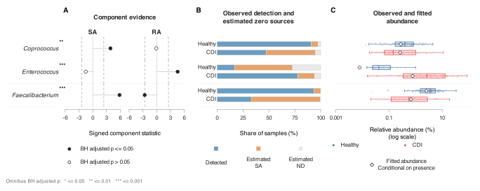

# SACAT

[](https://github.com/yiqianomics/SACAT/actions/workflows/R-CMD-check.yaml)

**Structural-Absence and Conditional-Abundance Testing** distinguishes two
sources of microbiome associations: changes in whether a taxon is present and
changes in its relative abundance when present.

An observed zero can arise because a taxon is absent or because sequencing
did not detect it. SACAT models counts together with each sample's sequencing
depth to distinguish evidence about these processes.

## What SACAT reveals

SACAT reports two complementary components:

- **Structural absence (SA):** differences between groups in the probability
  that a taxon is absent.
- **Relative abundance (RA):** differences in mean log relative abundance
  conditional on presence, standardized over sample covariates and centered
  against a reference estimated from other eligible taxa.

An omnibus test combines SA and RA evidence to identify associated taxa.
The component results then show whether an association is supported by
absence, abundance, or both. This connects discovery with an interpretation
of the underlying community differences.

SACAT accepts raw counts, sequencing depths, and sample metadata, with
covariate adjustment through an R formula. It returns component and omnibus
p-values, Benjamini–Hochberg (BH)-adjusted results, and an aligned visualization
of statistical evidence, observed detection, estimated zero sources, and
abundance distributions.

## Installation

```r
install.packages(c("Rcpp", "statmod", "remotes"))
remotes::install_github("yiqianomics/SACAT")
```

## Quick start

The package includes the Schubert stool microbiome dataset:
152 healthy controls and 91 participants with *Clostridioides difficile*
infection (CDI), with 88 taxa. The example compares CDI with healthy controls,
adjusting for age, sex, and reported antibiotic use.

The data come from [Schubert et al. (2014)](https://doi.org/10.1128/mBio.01021-14),
distributed through [MicrobiomeHD](https://doi.org/10.5281/zenodo.1146764).
Original library sizes are retained before taxon filtering.

```r
library(SACAT)
data("schubert_cdi")

fit <- sacat(
    counts = schubert_cdi$counts,
    metadata = schubert_cdi$metadata,
    formula = ~ age_z + sex + antibiotics_3mo + group,
    group = "group",
    reference = "H",
    library_size = "library_size",
    store_plot_data = TRUE
)

fit
head(fit$results)
```

For your own data, supply a count matrix with taxa in rows and samples in
columns, matching sample names to the row names of `metadata`. The first
factor level is the default reference group; `reference` sets it explicitly.
Include adjustment variables alongside the group in `formula`.

The results table contains separate SA, RA, and omnibus results; adjusted
p-value columns begin with `p_adj_`. See `?sacat` for function options and
`?schubert_cdi` for the example data.

## Visualize the results

```r
plot(
    fit, features = c("Coprococcus", "Enterococcus", "Faecalibacterium"),
    group_labels = c("Healthy", "CDI")
)
```



Three taxa illustrate support from SA, RA, or both components. **A** shows
SA/RA test evidence; **B** shows observed detection and estimated sources of
zeros; **C** shows positive observed abundances and fitted abundance conditional
on presence. All tests and BH adjustments use the full 88-taxon analysis.

[View the PDF](man/figures/schubert-cdi-example.pdf) or
[generate the figure](tools/make_readme_figure.R) from the repository root.
Add `file = "sacat-profile.pdf"` to save a plot.
See `?plot.sacat` for display options.

## Studies and figures

The repository includes model-based validation, simulations generated with
metaSPARSim, and applications to public microbiome data and a defined
spike-in experiment.

- [Internal model validation](Analysis/SimulationInternalValidation/README.md)
- [metaSPARSim simulations](Analysis/SimulationMetaSPARSim/README.md)
- [Real-data analyses and spike-in benchmark](Analysis/RealDataAnalysis/README.md)
- [Native-count negative controls](Analysis/NegativeControlAnalysis/README.md)
- [Main manuscript figures](Analysis/MainFigures/README.md)
